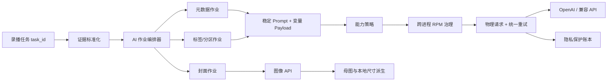
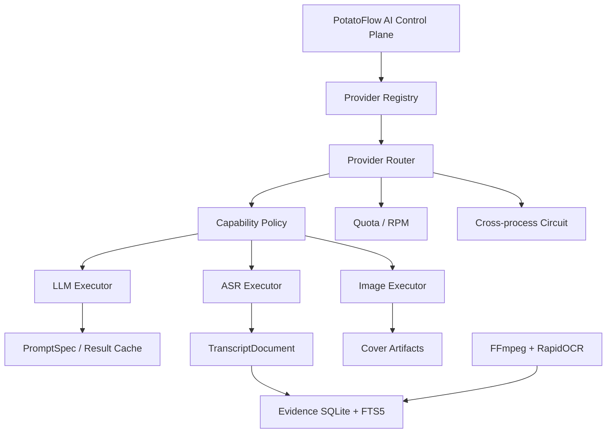
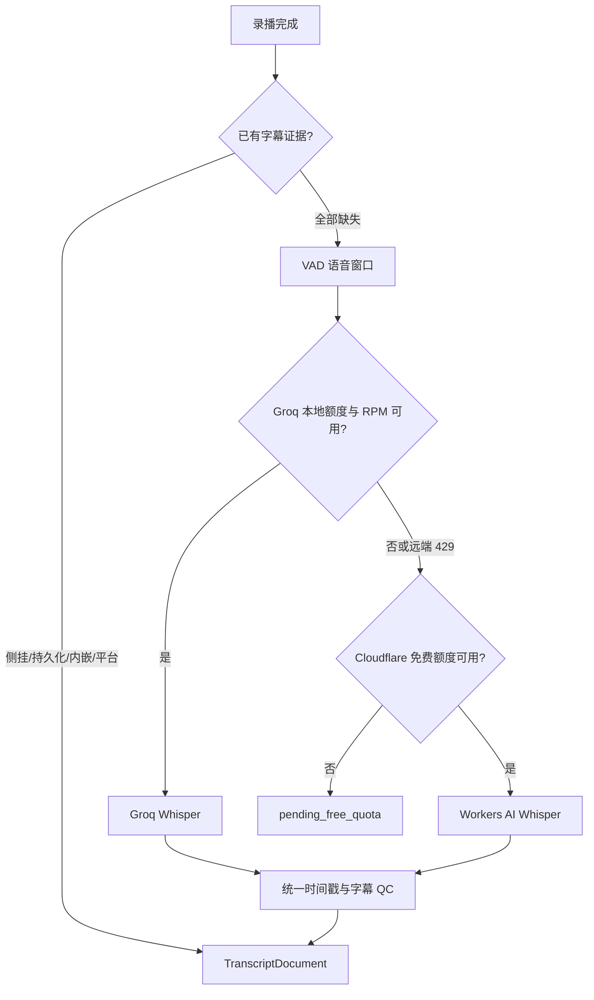
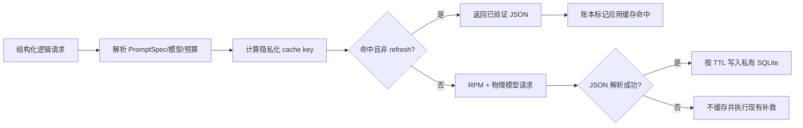

# AI 调用编排方案

## 2026-08-24 10:07

### 总体架构

### 1. Prompt 缓存策略

统一调用层根据端点和模型解析能力：

- 官方 OpenAI + GPT-5.6：在稳定 system 内容块末尾设置显式缓存断点，同时发送稳定 `prompt_cache_key` 与缓存 TTL。
- 官方 OpenAI 其他支持模型：发送稳定缓存键，继续使用自动提示词缓存。
- OpenAI 兼容端点：`auto` 模式不发送供应商专用字段；确认支持后可显式切换为 `explicit`。
- 缓存键只由模型、场景、稳定系统提示词哈希和有限分片组成，不包含 task_id、房间名或完整证据。
- 房间标题/简介偏好进入 `editorial_preferences` 用户负载；每次录播的字幕、弹幕、统计和时间线继续放在用户负载尾部。

配置：

| 配置项 | 默认值 | 作用 |
| --- | --- | --- |
| `OPENAI_PROMPT_CACHE_MODE` | `auto` | `auto` / `explicit` / `off` |
| `OPENAI_PROMPT_CACHE_TTL` | `30m` | `in-memory` / `30m` / `24h` |
| `OPENAI_PROMPT_CACHE_KEY_SHARDS` | `2` | 高吞吐时分散单一缓存键热度 |

OpenAI 官方建议稳定指令与示例在前、变量内容在后，并通过缓存 token 观测命中情况：[Prompt Caching](https://developers.openai.com/api/docs/guides/prompt-caching)。

### 2. 物理请求治理

`AiRequestGovernor` 使用独立 SQLite 数据库实现 60 秒滑动窗口。bucket 由端点和 API key 的不可逆摘要组成，既不会存储凭据，也能让多个 Python 进程共享同一个 RPM 上限。

SDK 自动重试固定关闭，统一调用层负责：

1. 获取 RPM 槽位；
2. 创建一条物理请求账本记录；
3. 执行一次 `chat.completions.create`；
4. 按 `Retry-After` 或指数退避处理 408、409、429、5xx、超时和连接错误；
5. 每次重试重新获取槽位并单独完成账本记录。

思考控制参数不兼容时的降级也是新的物理请求，因此同样通过上述边界。配置项为 `OPENAI_RPM_LIMIT`、`OPENAI_REQUEST_MAX_RETRIES` 和 `OPENAI_RETRY_BASE_SECONDS`。

### 3. 作业、会话和上下文边界

关系定义如下：

| 层级 | 标识 | 生命周期 | 是否共享上下文 |
| --- | --- | --- | --- |
| 录播任务 | `task_id` | 一次录制处理到投稿完成 | 只共享结构化事实与产物引用 |
| AI 作业 | `job_id` + `job_purpose` | 元数据、标签分区或某个封面 | 默认隔离 |
| 逻辑请求 | `run_id` + `scene_name` | 一次期望的模型结果 | 可包含 JSON/格式补救 |
| 物理请求 | `request_id` | 一次实际 SDK 请求 | 独立限速、计费和状态 |

独立弹幕批次不应串入一个 API conversation。Responses API 的 `previous_response_id` 适合“同一结果的连续修订”，但链中先前输入仍会计入后续输入 token，因此它不是免费缓存：[Conversation state](https://developers.openai.com/api/docs/guides/conversation-state)。

### 4. 渐进式披露

Prompt 分层顺序：

1. 全局输出契约和事实安全边界；
2. 任务类型规则，例如元数据、质检、翻译；
3. 仅在命中时加入的领域规则，例如 DOTA2、TI 赛事；
4. 本次结构化事实和证据索引；
5. 房间级语气、题材重点和文案偏好。

MVP 已先完成第 5 层从 system prompt 的迁移。后续应把当前大型元数据提示词拆成版本化 `PromptSpec`，并通过评测确认每个可选领域片段的增益后再加载。

### 5. 调用数量优化

- 弹幕/字幕先在本地去重、分窗和提取高显著性证据，再送模型；批次输出统一为紧凑结构，最终编辑只读取已核验候选。
- 相同输入的确定性分类、标签和分区任务可增加应用级结果缓存；人工“重新生成”必须显式绕过缓存。
- 延迟不敏感的历史重处理、离线评测和批量回填可进入 Batch API。Batch API 有独立限额池和成本优势，但完成窗口可达 24 小时，不适合直播结束后立即投稿：[Batch API](https://developers.openai.com/api/docs/guides/batch)。
- 同一录播的标题失败不能重新执行完整简介分析；重试只针对失败的最小阶段。

### 6. 封面策略

不建议把多个互不相关录播放进同一网格图再截图，原因是单格有效像素下降、主题相互污染、一次审核失败影响整批，并且文字和主体容易被裁切。

推荐路线：

1. 每个录播生成一张无文字或安全区明确的 Master Art；
2. 本地派生 16:9 和 4:3 构图；
3. 本地程序化叠加标题、主播名和 Logo；
4. 如果同一主题需要多个候选，可使用 Image API 的 `n` 在一次请求中生成多张，但图像输出成本仍随张数增长。

Image API 更适合单次图像生成，Responses API 更适合可持续编辑的图像对话：[Image generation](https://developers.openai.com/api/docs/guides/image-generation)。在完成安全区和文字渲染评测前，双尺寸独立生成保留为兼容路径。

### 7. Codex harness 对接边界

Codex core/App Server 可作为可选的 Agent Lane，而不是高吞吐 Pipeline Lane 的替代品。官方 App Server 提供 `Thread → Turn → Item` 生命周期、持久化/恢复、工具执行、审批和双向 JSONL/stdio 事件流；本地 Python 客户端可以启动固定版本的 App Server 子进程并实现 JSON-RPC binding。

适合首个 PoC 的场景是“录播元数据人工复核代理”：只读访问结构化时间线和已生成产物，允许提出并验证标题/简介修订，禁止 shell 写入和直接投稿。每个录播复核作业使用独立 thread，以 API key 模式运行，不读取 Codex/ChatGPT 登录 token。

不适合直接迁移的场景包括字幕逐批翻译、弹幕批次摘要、标签/分区分类和图像批量生成。这些固定流程继续使用 PotatoFlow 调用治理器，因为 Codex 的自动 compaction 不能替代 Prompt Caching、RPM、Retry-After 和图像成本控制；Agent loop 的工具调用还可能增加物理请求数。

参考：[Codex App Server 架构](https://openai.com/index/unlocking-the-codex-harness/) 与 [App Server 文档](https://developers.openai.com/codex/app-server)。

### 8. 分阶段路线

#### P0：本版本

- 统一提示词缓存能力策略；
- 跨进程 RPM 治理；
- 关闭 SDK 隐式重试并统一 Retry-After；
- 缓存写入 token 与作业边界记账；
- 动态房间偏好从系统提示词迁出；
- 字幕翻译、字幕质检、智能分段和元数据调用复用统一文本调用层。
- 录播任务新增独立 `ai_subtitle` 阶段：复用侧挂/持久化/内嵌/平台字幕，全部缺失且开启 ASR 时才生成 `_AI字幕.srt`；ASR 质检失败只降级弹幕证据，不阻断投稿。
- B站合集代码 `20080` 转为幂等跳过，并在读取确认后继续后续阶段。
- 移除 TI 2026 的常驻上下文、Liquipedia/OpenDota 专用核验、赛事封面模板及资源，防止过期赛事规则继续污染提示词前缀或触发外部请求。

#### P1：下一版本

- PromptSpec 版本化与条件领域片段；
- 确定性任务结果缓存和“重新生成”旁路；
- 按场景进行模型路由和 token 预算；
- 账本仪表盘展示 cache hit ratio、RPM、每作业成本和重试放大率；
- Master Art 单图封面 PoC。
- 只读 Codex App Server 元数据复核 PoC，测量质量、token、调用数和恢复能力。

#### P2：稳定化

- 基于固定样本集的标题、时间线、事实归属和封面评测；
- 离线任务接入 Batch API；
- 只把真正连续依赖的修订流迁移到 Responses API；
- 对供应商能力进行探测和版本化，不靠异常后的付费重试猜能力。

---

## 2026-08-24 11:45

### v1.6.128：Provider Control Plane 与 Evidence Layer

#### Provider 配置与执行边界

- `provider_control_plane.py` 只负责注册、能力匹配、场景/计费策略和共享熔断；Adapter 负责真实协议与响应归一化；业务层只声明请求能力。
- LLM Profile 按 1–4 优先级路由，场景过滤发生在发送请求前。每个 Profile 重新解析缓存能力和 RPM bucket，SDK 隐式重试仍关闭。
- Image Profile 同样按 1–4 路由。当前实现 `openai-compatible` 的 generate/edit；不支持的 adapter 不进入有效注册表。
- ASR `free_pool` 构造 `ProviderRequest(kind=asr, required=transcribe+segment_timestamp, preferred=word_timestamp, billing_mode=free_only)`；远端调用仍由免费额度台账原子预留。
- 熔断键包含 Provider ID、端点、模型和 Key 的 SHA-256 摘要。更换 Key 会立即获得新电路，但任何数据库都不保存 Key 明文。

#### Evidence Layer 与渐进式披露

`evidence.sqlite3` 持久化 `transcript_documents`、`transcript_segments`、FTS5、`visual_frames`、`evidence_records` 和 `evidence_events`。初始上下文只提供录播时长、语音段数、视觉证据数和候选事件数；模型需要细节时再调用 `search_speech` 或 `read_speech_segments`，禁止整份 Transcript/OCR/GSI/弹幕拼接进单个 Prompt。

OCR 执行器默认每 30 秒产生候选点，事件触发点优先占用最大帧预算；单线程 FFmpeg 抽帧后使用 dHash 去重。缓存键为 `frame_sha256 + ocr_model_version`。RapidOCR 结果过滤低置信度、单字符乱码和纯标点后，才写入 VisualEvidence。步骤失败为非阻断 warning。

任务流程顺序更新为：

`监控 → 录制 → 弹幕 → AI 字幕 → 内容证据索引 → OCR 视觉证据 → GSI/直播数据 → 编辑计划 → 封面 → 投稿`。

---

## 2026-08-24 11:20

### v1.6.128：免费 ASR Provider Pool

字幕源和 ASR 路由采用两层渐进披露：第一层只判断是否已有可信字幕，第二层仅在缺失时展开免费 Provider。

#### Provider Profile

每个 Provider 独立拥有凭据、模型和额度，而业务层只认识 `FreeAsrProviderRouter` 与 `AsrTranscriptionResult`。Groq 继续复用 OpenAI-compatible Whisper 客户端；Cloudflare 通过官方 Workers AI REST `ai/run` 接口适配，输出归一化为同一个时间段结构。

Groq 当前公开 Free Plan 上限为 20 RPM、每小时 7,200 音频秒、每天 28,800 音频秒；Cloudflare Workers AI 每天提供 10,000 免费 Neurons，其 Whisper 计量可折算为约 4 小时音频。实现采用可配置且略保守的滚动窗口，不能把这些数字当成永久合同：[Groq Rate Limits](https://console.groq.com/docs/rate-limits)、[Groq Speech to Text](https://console.groq.com/docs/speech-to-text)、[Cloudflare Workers AI Pricing](https://developers.cloudflare.com/workers-ai/platform/pricing/)。

#### 额度一致性

`asr-free-quota.sqlite3` 使用 `BEGIN IMMEDIATE` 原子预留，同一机器上的多个投稿进程共享 Provider 额度。台账只记录 Provider ID、时间、预留音频秒和 task ID，不保存凭据。每个免费 Provider 在路由层只执行一次尝试，失败后切换下一个，避免内部重试把同一段音频重复计入免费额度。

如果并发窗口中任一结果为 `pending_free_quota`，本次字幕整体不落盘，防止部分字幕被误认为完整 Transcript。后续任务重试可以在滚动额度恢复后重新执行；当前投稿仍可按既有非阻断策略使用弹幕证据。

---

## 2026-08-24 11:01

### v1.6.128：应用级结果缓存与场景路由

#### 1. PromptSpec Registry

新增只保存编排元数据的 `PromptSpec`：`name`、`version`、`cacheable`、`model_config_key` 和 `max_output_tokens`。业务模块继续拥有 Prompt 正文与输出校验，Registry 负责版本失效、模型路由和预算边界，避免再次形成一个无法渐进披露的全局巨型 Prompt 文件。

首批注册场景：

- `recording_danmaku_summary(_batch)`；
- `ai_enhancer_tags`；
- `ai_enhancer_content_profile`；
- `ai_enhancer_partition_selection`；
- `ai_enhancer_metadata_translate`；
- `subtitle_translate_batch(_strict)`；
- `subtitle_qc`。

标题生成、简介补救、JSON transport fallback、AI 分段 attempt 等场景不注册为可缓存场景。

#### 2. 结果缓存读写路径

缓存数据库只保存 key、场景、Prompt 版本、模型、生成结果 JSON、时间和命中次数。输入仅参与 SHA-256，不落盘；生成结果可能包含译文，因此采用私有目录/文件权限，并提供 `off` 模式。

#### 3. 场景模型与 Token 路由

- `OPENAI_METADATA_MODEL_NAME`：录播弹幕/字幕摘要；
- `OPENAI_CLASSIFICATION_MODEL_NAME`：标签、内容画像和分区；
- `OPENAI_TRANSLATION_MODEL_NAME`：标题/简介翻译；
- 字幕继续优先使用 `SUBTITLE_OPENAI_MODEL_NAME`，质检继续优先使用 `SUBTITLE_QC_MODEL_NAME`；
- `OPENAI_SCENE_MODEL_OVERRIDES` 和 `OPENAI_SCENE_TOKEN_BUDGETS` 提供精确场景覆盖。

场景预算只会收紧调用方已有 `max_tokens`，不会扩大输出。客户端连接池键包含路由、缓存和治理配置摘要，防止相同凭据下的人工旁路请求与自动任务相互污染。

#### 4. 观测

`ai_runs` 增加 `application_cache_hit` 与哈希 cache key；任务汇总增加 `application_cache_hit_count`。任务详情展示逻辑/物理请求、放大率、两级缓存指标、输入 Token 与成本。缓存命中仍保留一条逻辑 run，但不创建伪造的物理请求。

#### 5. 配置语义

| 模式 | 读取 | 写入 | 用途 |
| --- | --- | --- | --- |
| `auto` | 是 | 是 | 默认自动流程 |
| `read-only` | 是 | 否 | 冻结缓存评测 |
| `refresh` | 否 | 是 | 批量刷新 |
| `off` | 否 | 否 | 禁用或人工重新生成 |

默认 TTL 为 168 小时。PromptSpec 版本、模型或任何语义输入变化都会生成新 key，因此旧记录只等待 TTL 清理，不会被错误复用。

---
